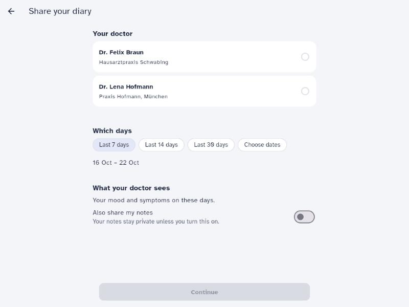
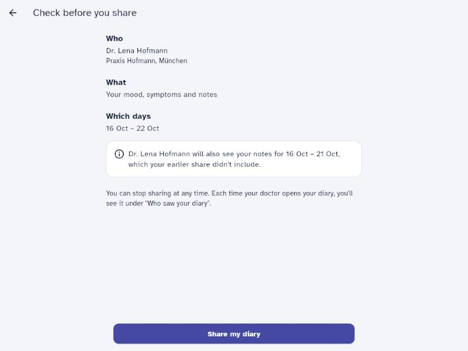
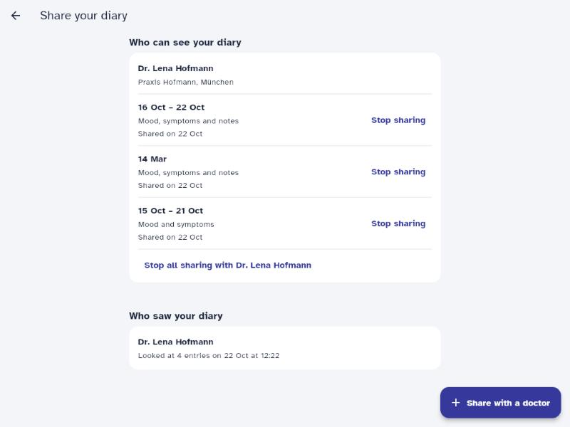

# Notes

Time spent: _(fill in)_

Status markers below: ✅ built and tested · 🚧 planned, not built yet.

## Assumptions and open questions

**Time zones: "the days as they see them in their diary"**

- The brief (Dr. Keller) says a shared period means the patient's days in "their own time zone",
  but nothing defines which time zone that is. The backend only knows `patients.timezone`
  (IANA name); the app knows the device time zone and never sends it.
- **Assumption:** `patients.timezone` is the patient's own time zone. When a share is created,
  that time zone is copied onto the share, and the period is read in it from then on.
- **Known gap:** the app groups the diary by the *device's* local time (`dayOf()` → `toLocal()`
  in `app/lib/format.dart`), not by `patients.timezone`. If the two differ (travel, a move
  without a profile update), entries near midnight can sit on one day in the patient's diary and
  on another day in the shared period. Nothing in the app or API lets the patient set their time
  zone today. See next steps.
- **`app-v1` entries** (Tom): their `recorded_at` is local wall-clock time stored as if it were
  UTC. When deciding whether such an entry falls inside a shared period, its stored date and time
  are read as the patient's local time, not converted. The rows themselves are not changed: that
  would be a migration on health data and would change what `/entries` returns to app v2.3.
- **Related finding, not fixed:** the patient's own diary shows `app-v1` entries at the wrong
  time already, because the app converts their fake-UTC timestamp to local time again. The seed
  entry at 23:50 on 14 March shows as 00:50 on 15 March in Berlin, the exact case Dr. Keller
  described.

**Not revealing who is a patient (Selin)**

- `GET /clinician/patients/{patient_id}/entries` returns exactly the same `404 {"detail": "Not
  found"}` in every case where the doctor may not read. That covers: patient doesn't exist, never
  shared, shared with another doctor, share revoked. Otherwise a doctor could loop over the
  sequential IDs and list who our patients are. `test_every_refusal_looks_the_same` compares the
  responses byte for byte.
- A doctor with an active share whose period has no entries gets `200 []`. That reveals nothing
  new: the patient told this doctor themself by sharing.
- No patient data in responses beyond the entries, and no patient IDs in metrics or logs.
- **Why not UUIDs?** They would make guessing IDs hard (defence in depth), but they don't fix the
  leak itself: a doctor can already hold a real ID (an old share, a referral letter). The
  responses have to look the same either way. API.md also fixes the IDs as integers and `/me`
  must not change, so a public UUID is a next step, not part of this change.

**Overlapping shares with the same doctor**

- Each share stands on its own. For each entry, a doctor sees the note if *any* active share
  covering that entry's day has `include_notes`. Revoking a share removes exactly what it
  granted.
- Rejected alternatives: "newest share wins" (creating a share would silently change an older
  consent) and "refuse overlaps" (API.md defines only `422` for invalid input, and refusing a
  valid request would annoy patients).
- To avoid confusing the patient, the confirmation step warns when a new share overlaps an
  active one with the same doctor, saying what changes for the overlapping days ("Dr. Lena
  Hofmann will also see your notes for 16 Oct – 21 Oct, which your earlier share didn't
  include"). The sharing screen groups active shares by doctor, each with its days, what it
  includes, "Shared on …" and its own "Stop sharing", plus "Stop all sharing with Dr. …" when
  there are several. (`app/lib/new_share_screen.dart`, `app/lib/sharing_screen.dart`)

**App**

- Entry point: "Share with your doctor" under the date on the diary screen. The patient's main
  action there stays "New entry".
- Sharing screen: "Who can see your diary", "Who saw your diary" ("Looked at 4 entries on 22 Oct
  at 12:22"), and "Past shares". Wording follows DESIGN.md ("your doctor", "who saw your
  diary", never "audit log").
- New share: pick a doctor, then "Last 7 / 14 / 30 days" (today included) or own dates, and
  "Also share my notes" (off by default). Days are the patient's local calendar days.
- Stopping a share asks for confirmation first ("Keep sharing" / "Stop sharing").
- Not built: a separate summary line per doctor merging overlapping periods; the per-share rows
  and the overlap warning cover it for now.

**Other assumptions**

- **Shares don't expire; they last until the patient revokes them.** The period says *which
  days* the doctor may read, not *until when*. "Last week" is always in the past when the doctor
  opens it. API.md has no expiry field. A patient who forgets to revoke leaves access open
  indefinitely, so an access window (e.g. the share ends 30 days after creation) is a next step
  to agree with product and data protection.
- `recorded_at` returned to a doctor is the real time: `app-v1` timestamps are repaired on the
  way out (read as local time in the share's time zone). `/entries` stays unchanged.
- A share's period may lie in the past or the future. Only `from_date > to_date` is invalid
  (`422`). An unknown `clinician_id` is invalid input (`422`, in FastAPI's usual validation error
  shape). Clinicians are a public list (`GET /clinicians`), so this reveals nothing.
- `created_at` and `revoked_at` come from the database clock and include microseconds
  (`2026-10-22T10:18:21.920361Z`). API.md's example has none; both are valid ISO 8601.
- Revoking a share that is already revoked returns it unchanged (`200`). Revoking another
  patient's share, or one that doesn't exist, returns `404`.
- Only reads that returned at least one entry are recorded in the access log. An empty answer
  disclosed no health data.
- Consent wording is versioned in code (a `consent_version` string stored on each share); the
  text itself lives in the repo.

## Data model decisions

Migration `backend/alembic/versions/0002_shares_and_access_log.py` ✅, models in
`backend/app/models.py` ✅, tests in `backend/tests/test_schema.py` ✅.

`diary_entries`, `patients` and `clinicians` are unchanged. `/entries` and `/me` keep their exact
shape for app v2.3.

**`shares`**: one row per consent.

| Column | Why |
| --- | --- |
| `patient_id` → patients, `clinician_id` → clinicians | Who shares with whom |
| `from_date`, `to_date` (`date`, inclusive, `CHECK from_date <= to_date`) | The patient agrees to calendar days, not timestamps |
| `timezone` | Copied from the patient when sharing, so a later profile change can't widen or shift the consent (O.Cons_1) |
| `include_notes` (default `false`) | Notes stay private unless the patient opts in (Selin, Dr. Keller) |
| `consent_version` | Which wording the patient agreed to (O.Cons_3) |
| `created_at`, `revoked_at` | Revoking sets a timestamp; shares are never deleted, because they are the proof of consent behind each access record |

Index on `(clinician_id, patient_id)` for the doctor's lookup. `timezone` and `consent_version`
are internal and not returned, because the API.md response shape is fixed.

**`access_log`**: one row per doctor read that returned entries.

| Column | Why |
| --- | --- |
| `patient_id` (no foreign key) | Whose diary was read; no FK so the record can outlive erasure |
| `clinician_id` → clinicians | Who read it; `clinician_name` in the response comes from joining `clinicians` |
| `accessed_at` | When (O.Log_1) |
| `entry_ids` (`int[]`, no FK) | Exactly which entries were disclosed |
| `notes_shown` | Whether notes were part of what was disclosed |

- **Append-only (O.Log_3):** a Postgres trigger rejects every `UPDATE` and `DELETE`. `TRUNCATE`
  stays possible so the test suite can reset tables; production would also deny it, and grant
  the app's database role only `INSERT` and `SELECT` on this table.
- ✅ The log row is committed before the response is sent. If the write fails, the doctor gets
  no data and `access_log_write_failures_total` goes up (O.Mon_1). No data leaves without a
  record.

## Requirements

| ID | Applies? | Where it is met (code, test), or why not |
| --- | --- | --- |
| O.Purp_1 | Yes | ✅ `ConfirmShareScreen` (`app/lib/new_share_screen.dart`) shows who (doctor and practice), what ("Your mood and symptoms. Your notes stay private." or "Your mood, symptoms and notes") and which days before "Share my diary". Test: `shares mood and symptoms for the last 7 days after showing what is shared` (`app/test/sharing_test.dart`). |
| O.Cons_1 | Yes | ✅ `GET /clinician/patients/{patient_id}/entries` (`backend/app/api.py`) returns only entries whose day, in the share's time zone, falls in an active share's period (`backend/app/sharing.py`); notes only if a covering share includes them. Tests in `tests/test_clinician_access.py`: period edges at midnight, `app-v1` entries, time zone kept on the share, overlapping shares. |
| O.Cons_2 | Yes | ✅ `POST /shares/{id}/revoke` sets `revoked_at`; every doctor read only considers shares without it. `test_revoking_stops_access`, and the overlapping-shares test (revoking one share removes just its notes). |
| O.Cons_3 | Yes | ✅ `shares.consent_version`, set from `CONSENT_VERSION` in `backend/app/api.py`; `test_share_keeps_the_patients_time_zone_and_consent_version`. |
| O.Auth_1 | Yes, not met | Authentication is a stub, so the patient can't re-authenticate. How I would: put the last authentication time in the token, have `POST /shares` reject one older than 15 minutes with `401` and a "re-authenticate" code, and let the app ask for the password or biometrics and retry. |
| O.Pass_1 | No | This feature adds no passwords. |
| O.Log_1 | Yes | ✅ Every doctor read that returns entries writes an `access_log` row (doctor, entry IDs, whether notes were shown, time), committed before the response. `test_patient_sees_who_read_their_diary`, `test_refused_reads_are_not_logged`. |
| O.Log_2 | Yes | ✅ `GET /access-log`, newest first, with the doctor's name; `test_patient_sees_who_read_their_diary`. App: "Who saw your diary" on the sharing screen; test `shows who saw the diary`. |
| O.Log_3 | Yes, partly | ✅ Append-only trigger, tested in `test_schema.py`. Ten-year retention: nothing deletes these rows; a retention job and backup policy are outside this repo. |
| O.Log_4 | Yes | ✅ **Fixed an existing violation:** `backend/app/main.py` logged every request body (moods, symptoms, notes). It now logs the route template (`/clinician/patients/{patient_id}/entries`) instead of the path or body, and uvicorn's own access log, which prints raw paths with patient IDs, is switched off. Test: `test_request_log_has_no_health_data`. Metrics use only bounded labels, never patient IDs. |
| O.Mon_1 | Yes | ✅ If the access-log write fails, the doctor gets no data and `access_log_write_failures_total` goes up; `test_no_data_leaves_when_the_read_cannot_be_logged`. 🚧 The alert rule itself (see Monitoring). |
| O.Err_1 | Yes | ✅ The clinician endpoint returns one generic 404, and a failed log write returns `500 {"detail": "Internal server error"}` without SQL (tested). The server log names only the exception type, since the message holds SQL and parameters. |
| O.Cryp_1 | Yes, outside this repo | Encryption at rest belongs to the database and disk setup (e.g. encrypted volumes, managed Postgres), not to application code. |
| O.Del_1 | Stretch goal, not built | See below. The schema is designed so erasure stays possible. |
| O.Doc_1 | Yes | This table. |

## Erasure (O.Del_1): how I would do it

Selin wants everything erased; Dr. Keller needs the record of which doctor saw what as clinical
evidence. Both can be met:

1. Delete the patient's `diary_entries`, then their `shares`, then the `patients` row, in one
   transaction. Foreign keys from those tables point at `patients`, so nothing is left behind.
2. Keep the `access_log` rows but pseudonymise them: replace `patient_id` with a keyed hash, so
   "Dr. X read 4 entries on 10 Oct" stays as evidence without saying whose they were. The log has
   no foreign keys to patients or entries, so step 1 doesn't touch it. `entry_ids` then point at
   entries that no longer exist, which is intended: they say what was disclosed, not what still
   exists.
3. The append-only trigger blocks step 2 for the normal app role. Erasure would run as a
   separate, audited database role that may only perform this update.
4. To decide with data protection and legal: the legal basis for keeping the pseudonymised
   records (likely the 10-year retention duty), and whether shares themselves must be kept as
   proof of consent in the same pseudonymised form.

## Monitoring

No label ever carries a patient ID or name. Counters ✅ built; alert rules and dashboard 🚧.

**Is sharing used, and do sharers keep logging? (Mara, in three months)**

- ✅ App events via `api.track()`: `sharing_opened`, `share_created`, `share_revoked`, alongside
  the existing `entry_created`. `sharing_opened` vs `share_created` shows how many patients look
  at sharing but don't go through with it.
- ✅ Backend counter `share_changes_total{action="created|revoked"}`, which doesn't depend on
  the app sending events (old app versions, blocked requests).
- Limitation: a Prometheus counter can't say whether *the patients who share* keep logging,
  because that needs per-patient data, which doesn't belong in metrics. For that I'd run a
  periodic query on the database (patients with a share vs without, entries per week before and
  after sharing) and report only the aggregate.

**Doctors can't open a diary (Lukas, on call)**

- ✅ `clinician_reads_total{outcome="ok|not_found|error"}` (all three exported from zero) and the existing request latency
  histogram for that route.
- ✅ `access_log_write_failures_total`.
- Page someone right away: any access-log write failure (O.Mon_1; doctors get no data), or the
  5xx rate on the clinician route above a few percent for 5 minutes on weekday mornings.
- Can wait until morning: rising latency, or a jump in `not_found` (could be a portal bug, or
  someone probing IDs).
- When it's on fire: a Grafana panel per outcome, latency, and the API logs, which carry the
  route and status but no bodies.

## Screenshots

Taken from the running app with the demo data (desktop browser width).

## How I used AI

_(fill in)_ Claude Code to read the codebase and summarise it, to walk through BRIEF.md and
REQUIREMENTS.md, and to discuss the schema before coding. Decisions I made or changed during
that discussion: the uniform `404 "Not found"`; storing the time zone on the share; the warning
before a new share overlaps an existing one; grouping shares by doctor and using the existing
`created_at` ("Shared on …") so patients can find and revoke a share. I reviewed the generated
migration and models before moving on.

## Next steps

- Let the patient set their time zone in the app, and/or send the device time zone when
  sharing, so the shared days always match the diary view.
- Fix how the app displays `app-v1` entries (read their wall-clock time as local).
- A public, non-guessable patient ID for clinician-facing URLs, agreed with the portal team as a
  new endpoint version; keep integer primary keys internal.
- An access window for shares (e.g. 30 days), so a forgotten share doesn't stay open forever.
- Rate-limit the clinician endpoint and alert on many `not_found` responses from one doctor.
- Re-authentication before sharing (O.Auth_1) once real authentication exists.
- Erasure as described above.
- A `consent_texts` table instead of a version string in code.
- Production database grants for `access_log` (`INSERT` and `SELECT` only, no `TRUNCATE`).
